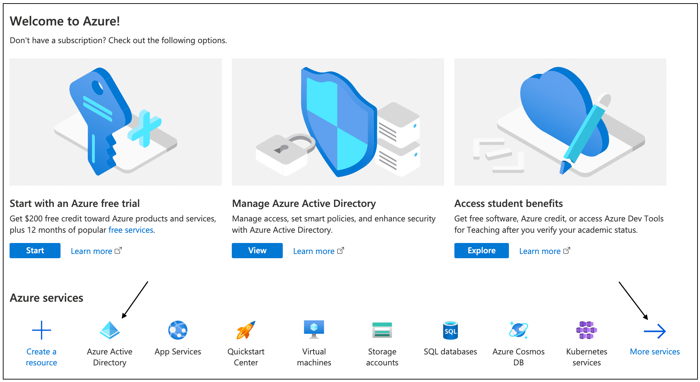

# Creating Azure AD Application

## Overview

Before you can use the Azure AD Extension, you need to create and configure an Azure Active Directory application registration. This application will serve as the identity for the extension when connecting to your Azure AD tenant and performing user and group management operations.

This guide will walk you through creating an Azure AD application, configuring the necessary permissions, setting up authentication, and obtaining the credentials needed for the extension.

## Prerequisites

Before starting, ensure you have:

- **Azure AD Tenant**: Access to an Azure Active Directory tenant
- **Administrative Privileges**: Global Administrator or Application Administrator role in Azure AD
- **Azure Portal Access**: Ability to access the Azure portal (portal.azure.com)
- **Krista Extension Details**: Access to your Krista environment to obtain the redirect URI

> **⚠️ Warning**: You need administrative privileges in Azure AD to complete this setup. If you don't have these permissions, contact your Azure AD administrator.

## Step-by-Step Instructions

### Step 1: Access Azure Active Directory

1. Navigate to the [Azure Portal](https://portal.azure.com)
2. Sign in with your Azure AD administrator account
3. In the left navigation pane, click **Azure Active Directory**
4. If you don't see Azure Active Directory in the left pane, click **All services** and search for "Azure Active Directory"

### Step 2: Navigate to App Registrations

1. In the Azure Active Directory overview page, click **App registrations** in the left navigation
2. Click **+ New registration** to create a new application

### Step 3: Register the Application

1. **Name**: Enter a descriptive name for your application (e.g., "Krista Azure AD Extension")
2. **Supported account types**: Select "Accounts in this organizational directory only"
3. **Redirect URI**: 
   - Select "Web" from the dropdown
   - Enter the redirect URI from your Krista extension (format: `https://your-krista-instance.com/extensions/extension-id/rest/azuread/callback`)
4. Click **Register**

> **📝 Note**: You can add additional redirect URIs later if needed. The exact redirect URI will be provided by your Krista extension configuration.

### Step 4: Note Application Details

After registration, you'll see the application overview page. Record the following information:

- **Application (client) ID**: This is your Client ID for the extension
- **Directory (tenant) ID**: This is your Tenant ID for the extension

### Step 5: Create Client Secret

1. In the left navigation of your app registration, click **Certificates & secrets**
2. Under **Client secrets**, click **+ New client secret**
3. **Description**: Enter a description (e.g., "Krista Extension Secret")
4. **Expires**: Choose an appropriate expiration period (recommended: 12-24 months)
5. Click **Add**
6. **Important**: Copy the secret **Value** immediately - it won't be shown again

> **⚠️ Critical**: Store the client secret securely. You cannot retrieve it again after leaving this page. If you lose it, you'll need to create a new one.

### Step 6: Configure API Permissions

1. In the left navigation, click **API permissions**
2. Click **+ Add a permission**
3. Select **Microsoft Graph**
4. Choose **Application permissions** (for service account mode)

### Step 7: Add Required Permissions

Add the following application permissions:

1. **Directory.ReadWrite.All**
   - Expand **Directory**
   - Check **Directory.ReadWrite.All**

2. **Group.ReadWrite.All**
   - Expand **Group**
   - Check **Group.ReadWrite.All**

3. **User.ReadWrite.All**
   - Expand **User**
   - Check **User.ReadWrite.All**

4. Click **Add permissions**

### Step 8: Grant Admin Consent

1. After adding permissions, click **Grant admin consent for [Your Organization]**
2. Click **Yes** to confirm
3. Verify that all permissions show "Granted for [Your Organization]" with green checkmarks

> **📝 Note**: Admin consent is required for application permissions. Without this step, the extension will not be able to access Azure AD resources.

### Step 9: Configure Authentication (Optional)

If you need to add additional redirect URIs or configure advanced authentication settings:

1. Click **Authentication** in the left navigation
2. Under **Redirect URIs**, you can add additional URIs if needed
3. Under **Advanced settings**, configure any additional options as required by your organization

### Step 10: Review and Verify Setup

Verify your application configuration:

- ✅ Application is registered with correct name
- ✅ Client ID and Tenant ID are recorded
- ✅ Client secret is created and securely stored
- ✅ Required API permissions are added
- ✅ Admin consent is granted for all permissions
- ✅ Redirect URI is configured correctly

## Verification Steps

### Verify Application Registration

1. Go to **Azure Active Directory** > **App registrations**
2. Find your application in the list
3. Click on the application name
4. Verify the **Application ID** and **Directory ID** match your records

### Verify Permissions

1. In your app registration, go to **API permissions**
2. Confirm all required permissions are listed
3. Verify the **Status** column shows "Granted for [Your Organization]"
4. Check that the **Type** column shows "Application" for the required permissions

### Verify Client Secret

1. Go to **Certificates & secrets**
2. Confirm your client secret is listed under **Client secrets**
3. Note the expiration date and set a reminder to renew before expiry

## Security Considerations

### Client Secret Management

- **Secure Storage**: Store the client secret in a secure location (password manager, key vault)
- **Access Control**: Limit access to the client secret to authorized personnel only
- **Rotation**: Plan to rotate the client secret before expiration
- **Monitoring**: Monitor for any unauthorized use of the application

### Permission Review

- **Principle of Least Privilege**: Only grant permissions necessary for the extension's functionality
- **Regular Audits**: Periodically review and audit application permissions
- **Usage Monitoring**: Monitor the application's usage and access patterns
- **Conditional Access**: Consider applying conditional access policies if required

## Troubleshooting

### Common Issues

#### Permission Denied During Setup
**Cause**: Insufficient privileges in Azure AD
**Resolution**: Contact your Azure AD Global Administrator to complete the setup

#### Cannot Grant Admin Consent
**Cause**: Missing administrative privileges
**Resolution**: Ask a Global Administrator to grant consent for the application

#### Client Secret Not Visible
**Cause**: Client secret value is only shown once during creation
**Resolution**: Create a new client secret and update the extension configuration

#### Application Not Found
**Cause**: Application may be created in wrong tenant or deleted
**Resolution**: Verify you're in the correct Azure AD tenant and recreate if necessary

## Next Steps

After completing the Azure AD application setup:

1. **[Configure Extension](/pages/ExtensionConfiguration.md)** - Set up the Azure AD Extension with your application credentials
2. **[Set Up Authentication](/pages/authentication.md)** - Configure authentication modes and test the connection
3. **Test Connection** - Verify the extension can successfully connect to your Azure AD tenant

## See Also

- [Extension Configuration](/pages/ExtensionConfiguration.md) - Complete extension setup guide
- [Authentication](/pages/authentication.md) - Authentication flow and token management
- [Microsoft Graph Permissions Reference](https://docs.microsoft.com/en-us/graph/permissions-reference) - Official permissions documentation
- [Azure AD App Registration Documentation](https://docs.microsoft.com/en-us/azure/active-directory/develop/quickstart-register-app) - Microsoft's official guide
