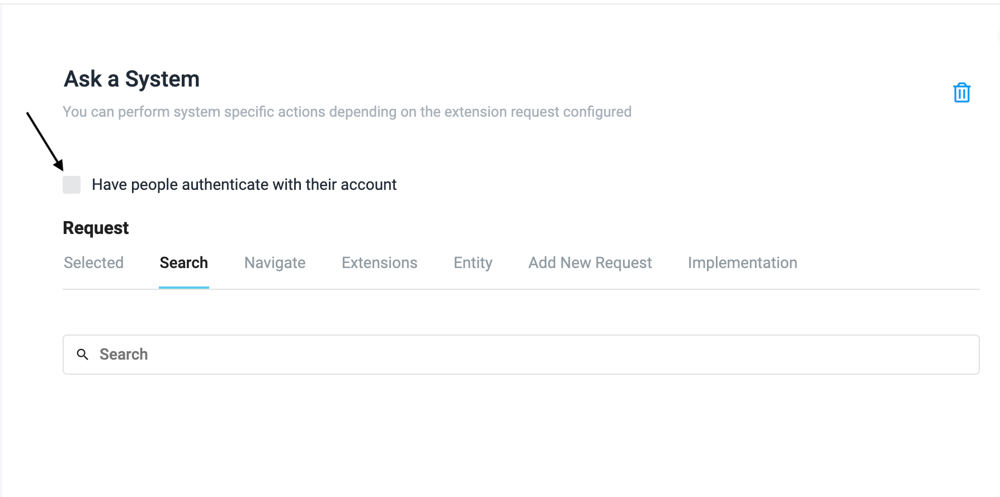
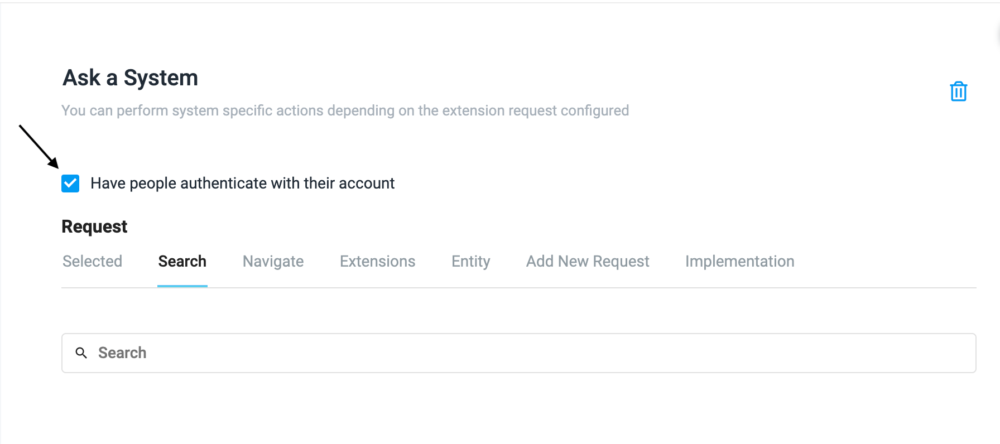
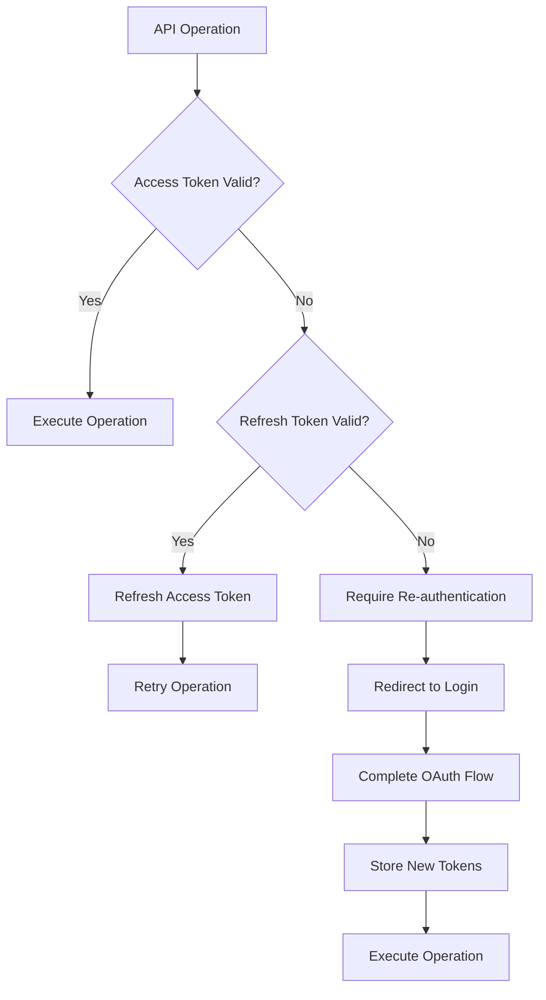

# Authentication

## Overview

The Azure AD Extension uses OAuth 2.0 authentication to securely connect with Microsoft's Azure Active Directory services. This extension supports two authentication modes: service account authentication for automated operations and user account authentication for user-specific actions. Understanding the authentication flow, token management, and security considerations is crucial for proper implementation.

## Authentication Modes

### Service Account Authentication

Service account authentication uses a single administrative account configured during extension setup to perform all operations on behalf of the system.

**When to Use**:
- Automated workflows and scheduled operations
- Bulk user management tasks
- System-level administrative operations
- Scenarios requiring consistent permissions

**Configuration**:
- Uses the administrator email specified in extension configuration
- Requires application-level permissions in Azure AD
- Single authentication during setup covers all operations

**Benefits**:
- Simplified token management
- Consistent permissions across operations
- No user interaction required during execution
- Suitable for background processes



### User Account Authentication

User account authentication requires each individual user to authenticate with their own Azure AD credentials when executing operations.

**When to Use**:
- User-specific operations requiring individual consent
- Scenarios where audit trails must show individual user actions
- Operations requiring user-specific permissions
- Compliance requirements for individual authentication

**Configuration**:
- Each user authenticates with their own credentials
- Uses delegated permissions on behalf of the authenticated user
- Individual consent required for each user

**Benefits**:
- Individual accountability and audit trails
- User-specific permission enforcement
- Granular access control
- Compliance with individual consent requirements



## OAuth 2.0 Scopes and Permissions

The Azure AD Extension requires specific Microsoft Graph API permissions to function properly. These permissions are configured in your Azure AD application registration.

### Required Scopes

#### Application Permissions (Service Account Mode)
```
https://graph.microsoft.com/User.ReadWrite.All
https://graph.microsoft.com/Group.ReadWrite.All
https://graph.microsoft.com/Directory.ReadWrite.All
```

#### Delegated Permissions (User Account Mode)
```
https://graph.microsoft.com/User.ReadWrite
https://graph.microsoft.com/Group.ReadWrite.All
https://graph.microsoft.com/Directory.Read.All
```

### Permission Details

#### User.ReadWrite.All (Application) / User.ReadWrite (Delegated)
- **Purpose**: Create, read, update, and delete user accounts
- **Operations Enabled**:
  - Create new user accounts
  - Update user profile information
  - Reset user passwords
  - Activate/deactivate user accounts
  - Read user details

#### Group.ReadWrite.All
- **Purpose**: Manage group memberships and read group information
- **Operations Enabled**:
  - Add users to groups
  - Remove users from groups
  - Read group information
  - List available groups

#### Directory.ReadWrite.All (Application) / Directory.Read.All (Delegated)
- **Purpose**: Read directory information and perform directory operations
- **Operations Enabled**:
  - Search for users and groups
  - Access directory metadata
  - Perform administrative operations

### Alternative Scopes

**Why not use User.Read.All?**
- User.Read.All provides read-only access to user information
- The extension requires write permissions for user management operations
- User.ReadWrite.All is necessary for creating, updating, and deleting accounts

**Why not use lower-privilege delegated permissions?**
- Many operations require administrative privileges
- Service account mode needs application-level permissions for system operations
- Delegated permissions are used when user-specific context is required

## OAuth 2.0 Grant Types

The Azure AD Extension uses two primary OAuth 2.0 grant types for authentication and token management.

### Authorization Code Grant

**Grant Type**: `authorization_code`
**Used For**: Initial authentication and obtaining access/refresh tokens
**Flow**: Interactive authentication requiring user consent

**Request Example**:
```http
GET https://login.microsoftonline.com/{tenant-id}/oauth2/v2.0/authorize?
client_id={client-id}&
response_type=code&
redirect_uri={redirect-uri}&
response_mode=query&
scope=https://graph.microsoft.com/User.ReadWrite.All https://graph.microsoft.com/Group.ReadWrite.All&
state={state-value}
```

**Response Example**:
```http
HTTP/1.1 302 Found
Location: {redirect-uri}?code={authorization-code}&state={state-value}
```

**Token Exchange Request**:
```http
POST https://login.microsoftonline.com/{tenant-id}/oauth2/v2.0/token
Content-Type: application/x-www-form-urlencoded

client_id={client-id}&
scope=https://graph.microsoft.com/User.ReadWrite.All&
code={authorization-code}&
redirect_uri={redirect-uri}&
grant_type=authorization_code&
client_secret={client-secret}
```

**Token Exchange Response**:
```json
{
  "token_type": "Bearer",
  "scope": "https://graph.microsoft.com/User.ReadWrite.All",
  "expires_in": 3600,
  "access_token": "eyJ0eXAiOiJKV1QiLCJhbGciOiJSUzI1NiIsIng1dCI6Ik5HVEZ2ZEstZnl0aEV1Q...",
  "refresh_token": "AwABAAAAvPM1KaPlrEqdFSBzjqfTGAMxZGUTdM0t4B4..."
}
```

### Refresh Token Grant

**Grant Type**: `refresh_token`
**Used For**: Obtaining new access tokens without user interaction
**Flow**: Automatic token refresh using stored refresh token

**Request Example**:
```http
POST https://login.microsoftonline.com/{tenant-id}/oauth2/v2.0/token
Content-Type: application/x-www-form-urlencoded

client_id={client-id}&
scope=https://graph.microsoft.com/User.ReadWrite.All&
refresh_token={refresh-token}&
grant_type=refresh_token&
client_secret={client-secret}
```

**Response Example**:
```json
{
  "token_type": "Bearer",
  "scope": "https://graph.microsoft.com/User.ReadWrite.All",
  "expires_in": 3600,
  "access_token": "eyJ0eXAiOiJKV1QiLCJhbGciOiJSUzI1NiIsIng1dCI6Ik5HVEZ2ZEstZnl0aEV1Q...",
  "refresh_token": "AwABAAAAvPM1KaPlrEqdFSBzjqfTGAMxZGUTdM0t4B4..."
}
```

## Authentication Flow

### Initial Authentication Process

1. **User Initiates Authentication**
   - User accesses extension or performs operation requiring authentication
   - Extension redirects to Azure AD authorization endpoint

2. **Azure AD Authorization**
   - User enters credentials on Microsoft's secure login page
   - Azure AD validates credentials and permissions
   - User grants consent for requested permissions (if required)

3. **Authorization Code Return**
   - Azure AD redirects back to extension with authorization code
   - Extension receives code via configured redirect URI

4. **Token Exchange**
   - Extension exchanges authorization code for access and refresh tokens
   - Tokens are securely stored for future use

5. **API Access**
   - Extension uses access token to make Microsoft Graph API calls
   - Operations are performed on behalf of authenticated user/service account

### Subsequent Operations

1. **Token Validation**
   - Extension checks access token validity before each operation
   - Validates token expiration and scope requirements

2. **Automatic Refresh**
   - If access token is expired, extension automatically uses refresh token
   - New access token obtained without user interaction
   - Operations continue seamlessly

3. **Error Handling**
   - If refresh token is invalid/expired, re-authentication is required
   - User is redirected to authentication flow
   - Appropriate error messages are displayed

## Token Management

### Access Token Lifecycle

**Lifetime**: 1 hour (3600 seconds)
**Purpose**: Authorizes API calls to Microsoft Graph
**Storage**: Securely stored in extension memory
**Refresh**: Automatic using refresh token before expiration

**Access Token Properties**:
- Contains user/application identity information
- Includes granted permissions (scopes)
- Digitally signed by Azure AD
- Cannot be renewed - must be replaced

### Refresh Token Lifecycle

**Lifetime**: Variable based on application type and usage
- **Verified Applications**: Up to 90 days of inactivity
- **Unverified Applications**: Up to 24 hours
- **Continuous Usage**: Can be valid indefinitely with regular use

**Purpose**: Obtain new access tokens without user interaction
**Storage**: Securely encrypted and stored
**Rotation**: New refresh token may be issued with each refresh

**Refresh Token Properties**:
- Longer lifetime than access tokens
- Can be revoked by user or administrator
- Subject to conditional access policies
- May expire due to security events

## Token Expiration Scenarios

Understanding token expiration scenarios is crucial for maintaining reliable authentication and handling edge cases appropriately.

### Access Token Expiration

**Frequency**: Every 1 hour
**Handling**: Automatic refresh using refresh token
**User Impact**: None (transparent to user)

**Process**:
1. Extension detects expired access token before API call
2. Automatically uses refresh token to obtain new access token
3. Retries original operation with new token
4. Operation completes successfully

### Refresh Token Expiration

Refresh tokens can expire due to various conditions:

#### Inactivity Expiration
- **Verified Apps**: 90 days of no usage
- **Unverified Apps**: 24 hours of no usage
- **Resolution**: Re-authentication required

#### Security Events
- **User password change**: Refresh token immediately invalidated
- **Account disabled**: All tokens revoked
- **Suspicious activity**: Tokens may be revoked as security measure
- **Resolution**: Re-authentication required

#### Administrative Actions
- **Admin revokes consent**: Application permissions removed
- **Conditional access changes**: May invalidate existing tokens
- **Tenant policy changes**: Can affect token validity
- **Resolution**: Re-authentication and possible reconfiguration required

#### Token Limits
- **Maximum active tokens**: Azure AD limits concurrent refresh tokens per user/app
- **Token rotation**: Old tokens invalidated when limits exceeded
- **Resolution**: Re-authentication required

### Expiration Handling Flow



## Security Best Practices

### 1. Token Security
- **Never log tokens**: Tokens should never appear in logs or debug output
- **Secure storage**: Use encrypted storage for refresh tokens
- **Memory protection**: Clear tokens from memory when no longer needed
- **Transmission security**: Always use HTTPS for token-related communications

### 2. Permission Management
- **Principle of least privilege**: Request only necessary permissions
- **Regular audits**: Review and remove unused permissions
- **Scope validation**: Verify tokens contain required scopes before operations
- **Permission monitoring**: Monitor for permission changes or revocations

### 3. Error Handling
- **Graceful degradation**: Handle authentication failures gracefully
- **User communication**: Provide clear error messages for authentication issues
- **Retry logic**: Implement appropriate retry mechanisms for transient failures
- **Logging**: Log authentication events for security monitoring (without sensitive data)

### 4. Compliance Considerations
- **Data residency**: Understand where tokens and data are stored
- **Audit trails**: Maintain logs of authentication events
- **Retention policies**: Follow organizational policies for token retention
- **Privacy compliance**: Ensure authentication practices comply with privacy regulations

## Troubleshooting Authentication

### Common Authentication Issues

#### "invalid_client" Error
**Cause**: Incorrect Client ID or Client Secret
**Resolution**:
1. Verify Client ID matches Azure AD app registration
2. Ensure Client Secret is current and not expired
3. Check for typos in credentials
4. Regenerate Client Secret if necessary

#### "unauthorized_client" Error
**Cause**: Application not authorized for requested operation
**Resolution**:
1. Verify application permissions in Azure AD
2. Ensure admin consent has been granted
3. Check that application is enabled
4. Review conditional access policies

#### "invalid_scope" Error
**Cause**: Requested permissions not available or configured
**Resolution**:
1. Review API permissions in Azure AD app registration
2. Ensure required scopes are properly configured
3. Verify scope syntax in authentication requests
4. Check for permission dependencies

#### "redirect_uri_mismatch" Error
**Cause**: Redirect URI doesn't match registered URI
**Resolution**:
1. Verify redirect URI in Azure AD app registration
2. Check for exact match including protocol, domain, and path
3. Ensure no trailing slashes or case mismatches
4. Update registration if URI has changed

### Advanced Troubleshooting

#### Intermittent Authentication Failures
**Possible Causes**:
- Network connectivity issues
- Azure AD service disruptions
- Token synchronization problems
- Clock skew between systems

**Resolution Steps**:
1. Check network connectivity to Azure AD endpoints
2. Verify system clock synchronization
3. Monitor Azure AD service health
4. Implement retry logic with exponential backoff

#### Performance Issues
**Possible Causes**:
- Excessive token refresh requests
- Inefficient token caching
- Network latency to Azure AD

**Resolution Steps**:
1. Optimize token refresh timing
2. Implement proper token caching
3. Monitor authentication request patterns
4. Consider regional Azure AD endpoints

## See Also

- [Extension Configuration](/pages/ExtensionConfiguration.md) - Complete setup and configuration guide
- [Creating Azure App](/pages/CreatingAzureApp.md) - Azure AD application setup
- [Microsoft Graph Authentication Documentation](https://docs.microsoft.com/en-us/graph/auth/) - Official authentication reference
- [Azure AD OAuth 2.0 Documentation](https://docs.microsoft.com/en-us/azure/active-directory/develop/v2-oauth2-auth-code-flow) - OAuth 2.0 flow details