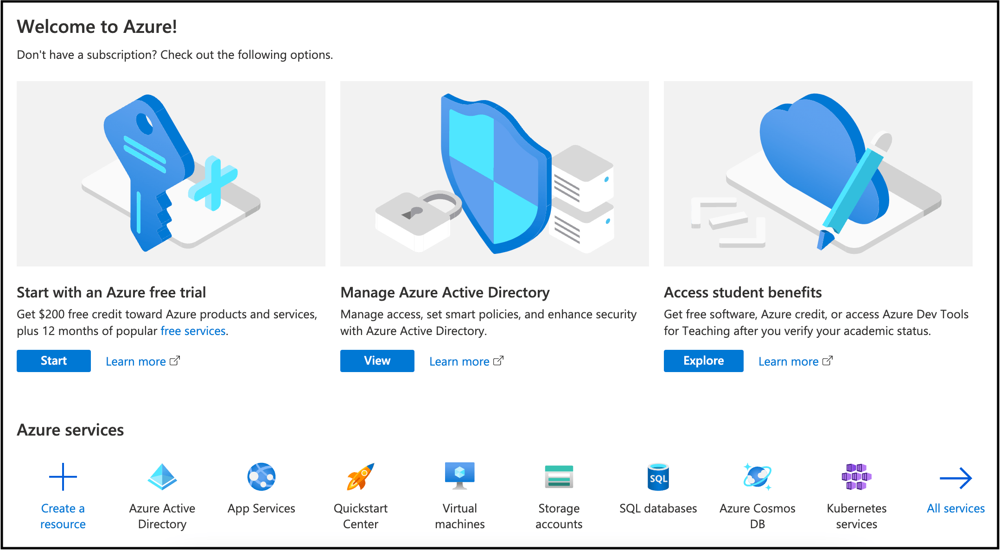
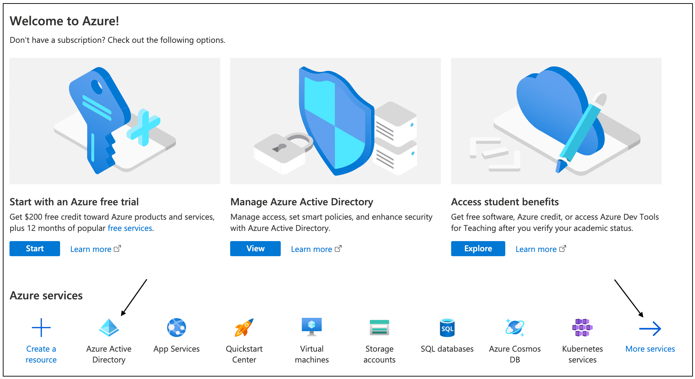

### Obtaining Client ID, Tenant ID, and Client Secret

* For the Azure AD Extension, you would need to obtain Client ID, Tenant ID, and Client Secret from the Azure Portal.

### Steps to get Client ID, Tenant ID, and Client Secret

* Log in to the Azure portal at [Click Here](https://portal.azure.com/).
  

* Under **Azure services**, click **Azure Active Directory**. If not found readily click **More services** to find Azure Active Directory.
  

* On the following Overview page, click **App registrations** under the **Manage** column menu.
  

* At the top of the page, click **New Registration**. Alternatively, open your pre-existing application.
  

* **Register an application** page is displayed. Enter the relevant details on this application page. Enter the **Name** that would be display name. Select the **Supported account types**. Out of the available options, select accounts in the single tenant only (first option). Under Redirect URI, select the Web platform. Add the authorized redirect URI corresponding to your Outlook extension. Click **Register**.
  
  

* After registration, in **Overview**, under **Essentials**, you will find the Client ID and Tenant ID.
  

* Click **Certificates & secrets**, go to and click **New client secret**.
  

* On the **Add a client secret panel**, enter the **Description**, and set up the time span of expiry in the **Expires** field. Click **Add**.
  

* On the following page, you will see the Client Secret under **Value**.
  

* Save the Client ID, Tenant ID, and Client Secret for future reference.

* You must provide these values in your extension to proceed with the operations such as catalog requests and invoker request.
  